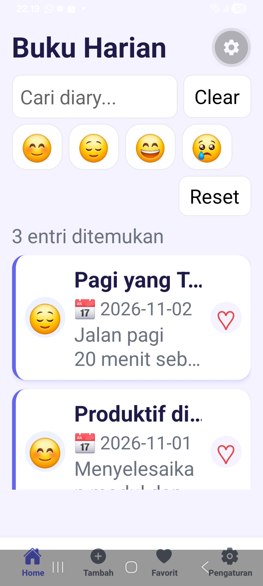
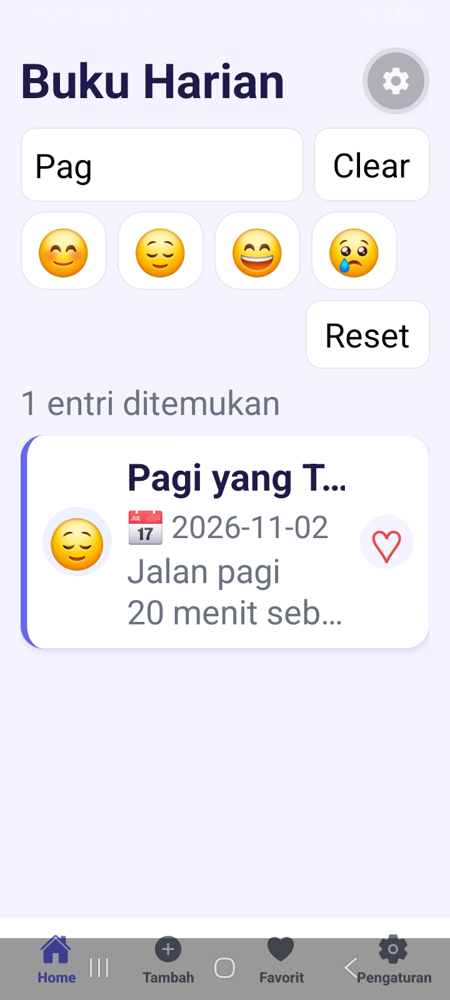
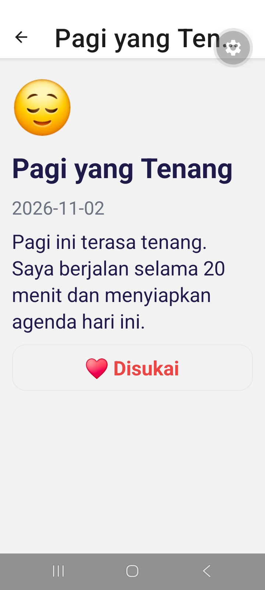
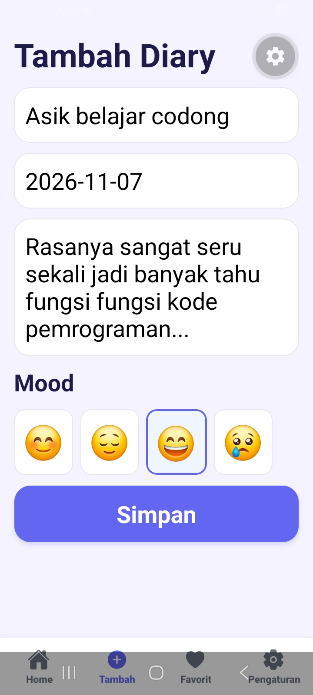
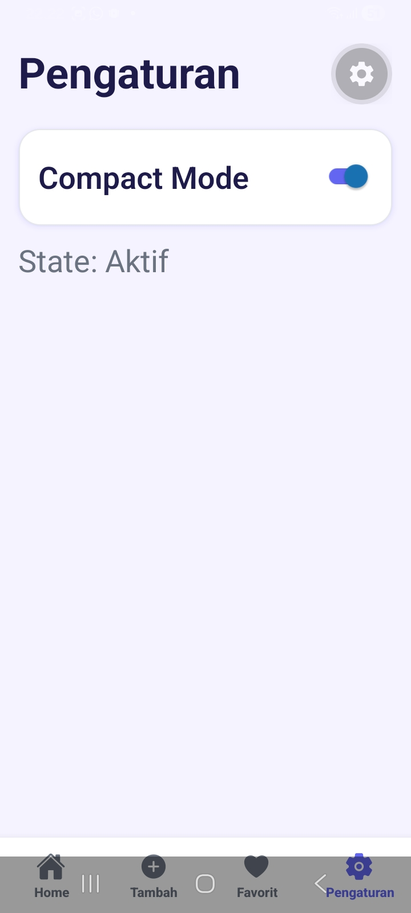
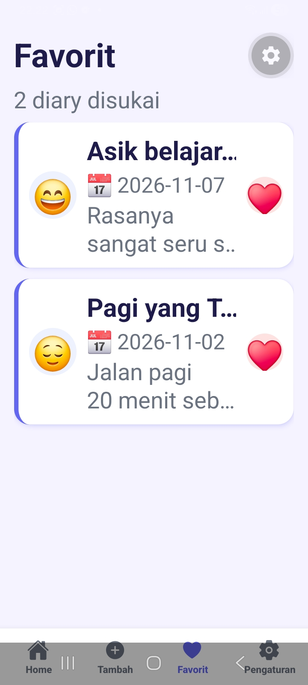

# Diary App (diary-app6)

- Nama : Mohamad Yusup
- NIM  : 2440511006
- Mata Kuliah : Mobile Multi Platform Kelas C, Pertemuan 6
- Dosen Pengampu: PRAJOKO, M.KOM

## Cara Menjalankan
```bash
npm install
npx expo start -c
```
Tekan `a` untuk Android Emulator, atau scan QR dengan Expo Go.

## Tampilan Aplikasi







## Penjelasan Hooks
| Hook | Lokasi | Input | Output | Dependency | Alasan |
|------|--------|-------|--------|------------|--------|
| useState | DiaryContext | INITIAL_ENTRIES, new Set() | entries, likedIds + setter | - | Sumber shared state |
| useContext | useDiary() | DiaryContext | entries, addEntry, toggleLike, getById | - | Akses shared state tanpa prop drilling |
| useEffect | useDiarySearch | query | debouncedQuery | [query] | Debounce 350 ms dengan cleanup clearTimeout |
| useMemo | useDiarySearch | entries, debouncedQuery | filteredEntries | [entries, debouncedQuery] | Derived data, tidak dihitung ulang tanpa perubahan |
| useCallback | HomeScreen | id / setQuery | openDetail, clearSearch | [router], [setQuery] | Referensi callback stabil |
| useRef | HomeScreen | - | searchRef | - | Fokus ke TextInput tanpa re-render |
